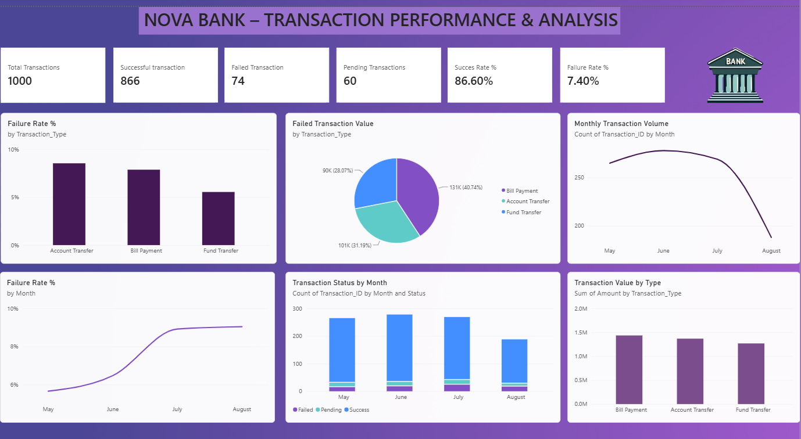

# Nova Bank — Digital Banking Analysis

## Project Overview
An end-to-end digital banking analytics project focused on identifying transaction failures, understanding customer payment issues, and recommending improvements to the digital banking experience.

## Business Problem
Digital banking users may experience failed or pending transactions, delays in bill payments, and difficulties completing account transfers. These issues can affect customer satisfaction and increase support demand.

## Objectives
- Analyze transaction outcomes and failure patterns.
- Compare transaction performance by type and month.
- Identify high-value failed transactions.
- Highlight opportunities to improve digital banking reliability.

## Tools & Technologies
- **Power BI:** Interactive dashboards and visual analysis
- **PostgreSQL:** Data querying and analysis

## Key Findings
- Bill payments recorded a failed transaction value of approximately 131K, with a failure rate of 40.74%.
- Account transfers showed a comparatively higher failure rate.
- July showed a higher number of transaction failures in the analyzed dataset.
- High-value failed transactions were examined using an amount threshold of 50,000.

## Business Recommendations
- Investigate the causes of bill payment failures.
- Review account transfer processing and error-handling workflows.
- Monitor monthly transaction failures using operational KPIs.
- Introduce alerts and exception reporting for high-value failed transactions.

## Project Deliverable
Power BI dashboard for analyzing digital banking transaction performance and identifying areas for operational improvement.

## Dashboard Preview

*Note: Findings reflect the analyzed dataset and should not be interpreted as actual Nova Bank operational results.*
